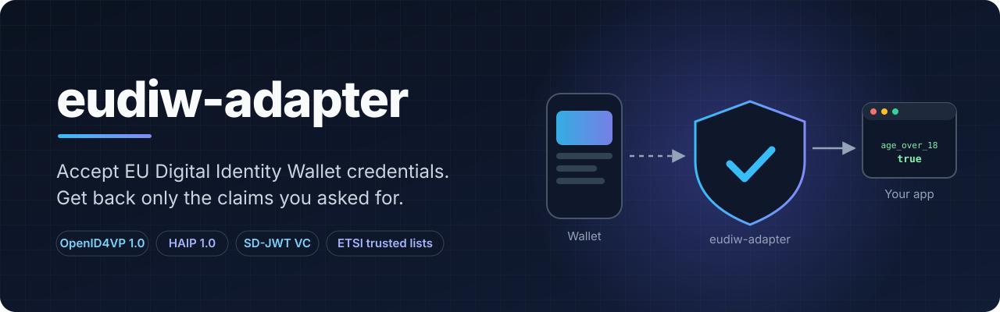
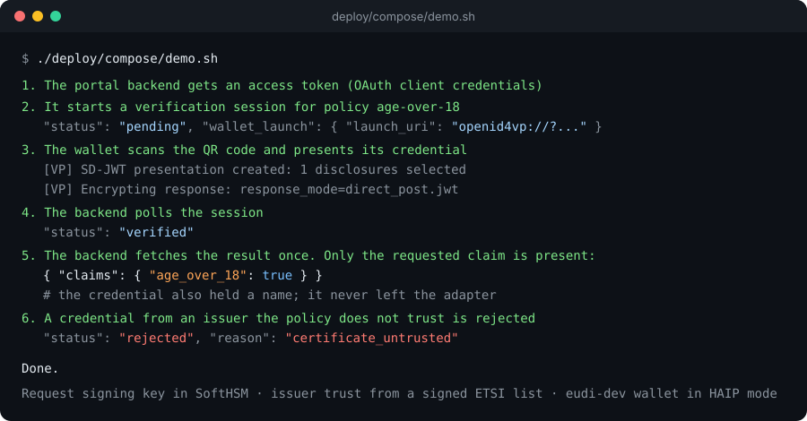
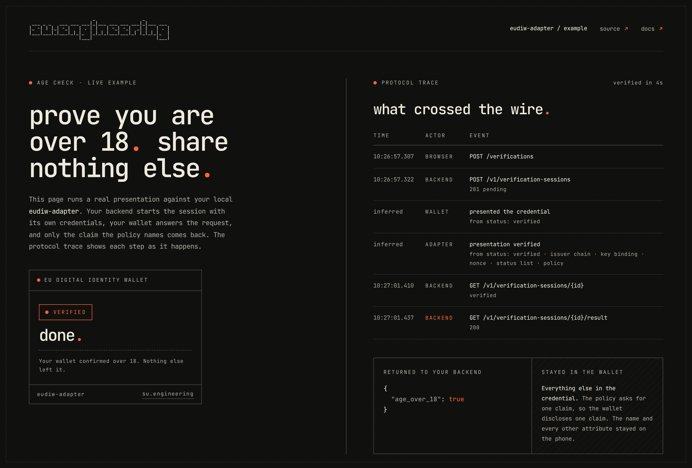
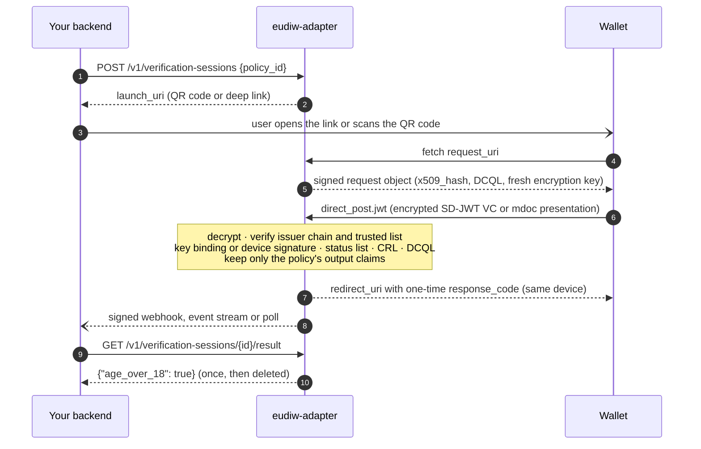
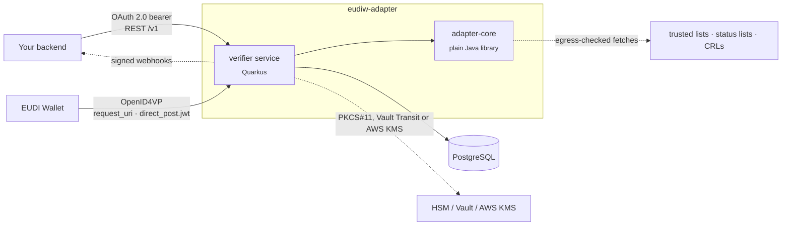

<div align="center">



<h3>The open-source EUDI Wallet verifier for relying parties</h3>

<p>Self-hosted service and Java library. Verifies SD-JWT VC and ISO mdoc presentations over OpenID4VP 1.0 and HAIP 1.0,<br>and hands your backend only the claims it asked for.</p>

[](https://github.com/su-engineering/eudiw-adapter/actions/workflows/ci.yaml)
[](LICENSE)


[](docs/kubernetes.md)

[**Quickstart**](#quickstart) · [**How it works**](#how-it-works) · [**Features**](#features) · [**Docs**](#documentation) · [**Security**](SECURITY.md)

</div>

> [!NOTE]
> **Pre-1.0.** Releases and what changed in each are in the [changelog](CHANGELOG.md); before 1.0.0 a minor version can change the API or the configuration format. The [feature matrix](docs/standards-matrix.md) lists exactly what is implemented and how it is tested. "Supported" means automated tests pass for a pinned version of a standard. It is not a conformance or certification claim.

## Why

The EU Digital Identity Wallet (EUDI Wallet, eIDAS 2.0) lets people prove facts about themselves from their phone. Accepting it means implementing a stack of new standards correctly. eudiw-adapter puts that stack behind one small REST API.

<table>
<tr>
<th width="50%">Without it, your application has to</th>
<th width="50%">With eudiw-adapter, your application</th>
</tr>
<tr>
<td>

- build and sign OpenID4VP request objects
- decrypt `direct_post.jwt` responses (ECDH-ES)
- verify SD-JWT disclosures and key binding
- parse CBOR and verify ISO mdoc issuer and device signatures
- validate issuer X.509 chains, trusted lists, CRLs
- check Token Status Lists
- decide what personal data to keep, and protect it

</td>
<td>

- calls `POST /v1/verification-sessions`
- shows a QR code or deep link
- reads `{"age_over_18": true}`

That's all. Nothing else the wallet disclosed ever reaches your systems.

</td>
</tr>
</table>

**Typical uses:** age verification without collecting a birth date, attribute checks at onboarding or checkout (residency, nationality, a qualification), adding wallet presentation to an existing web or mobile product. For wallet *login* inside Keycloak, see [keycloak-oid4vp](https://github.com/su-engineering/keycloak-oid4vp).

## Quickstart

Requirements: Docker, `curl`, `jq`; Java 21 for the full demo.

Without cloning anything (Docker, `curl` and `jq` only; runs the released image with a file key):

```bash
curl -fsSL https://raw.githubusercontent.com/su-engineering/eudiw-adapter/main/deploy/quickstart/run.sh | sh
```

The full demo, built from source:

```bash
git clone https://github.com/su-engineering/eudiw-adapter.git && cd eudiw-adapter
./deploy/compose/demo.sh
```

<div align="center">

</div>

The demo runs PostgreSQL, Keycloak (as your OAuth server) and the adapter, then plays both sides with the independent [eudi-dev](https://github.com/eudi-dev/eudi-dev) wallet in HAIP mode:
- The adapter's request-signing key is generated inside SoftHSM and never leaves it.
- Issuer trust comes from a signed ETSI trusted list.
- The credential also holds a name, but only `age_over_18` comes back.
- The same check then runs with an ISO mdoc PID, and an mdoc signed over another session's transcript is rejected.

With the demo running, `./deploy/compose/waltid/run.sh` repeats the SD-JWT VC and mdoc checks with a second, unrelated wallet, [walt.id Wallet API 2](https://github.com/walt-id/waltid-identity/tree/main/waltid-services/waltid-wallet-api2).

The same demo and the walt.id run happen in CI on every commit. The demo uses plain HTTP on localhost with `EUDIW_PRODUCTION=false`; production requires HTTPS.

With the demo running, `node examples/node/server.mjs` serves an example page on http://localhost:3000 that runs the same check in the browser with the [`<eudiw-request>`](clients/web) component and shows each protocol step as it happens ([how to run it](examples/README.md)).

<div align="center">

</div>

## How it works



<details>
<summary><b>The API calls in full</b></summary>

```bash
# 1. Start a session (OAuth 2.0 client-credentials token with verification:create)
curl -X POST https://adapter.example/v1/verification-sessions \
  -H "Authorization: Bearer $TOKEN" -H "Idempotency-Key: $(uuidgen)" \
  -H 'Content-Type: application/json' \
  -d '{"policy_id":"age-over-18","mode":"same_device","client_reference":"order-42"}'
```

```json
{
  "id": "vrs_2SzKUQQugO51nHJtOptDBowHzwztWwdf8lyMvVvAN9E",
  "status": "pending",
  "policy_id": "age-over-18",
  "wallet_launch": { "launch_uri": "openid4vp://?client_id=x509_hash%3A...&request_uri=..." }
}
```

```bash
# 2. Wait for the outcome: poll, take the webhook, or follow the event stream. The last event counts: if the
#    stream closes on "pending" (token expired, node restarted), reconnect with a fresh token or poll.
curl -N https://adapter.example/v1/verification-sessions/$ID/events -H "Authorization: Bearer $TOKEN"
#    event: status
#    data: {"id":"vrs_...","status":"verified",...,"result_available":true}

# 3. Fetch the result once
curl https://adapter.example/v1/verification-sessions/$ID/result -H "Authorization: Bearer $TOKEN"
```

```json
{
  "id": "vrs_2SzKUQQugO51nHJtOptDBowHzwztWwdf8lyMvVvAN9E",
  "status": "verified",
  "policy_id": "age-over-18",
  "verified_at": "2026-11-16T23:33:30Z",
  "claims": { "age_over_18": true },
  "credential_evidence": [
    { "format": "dc+sd-jwt", "credential_type": "https://credentials.example/age", "issuer": "https://issuer.example" }
  ]
}
```

Show `launch_uri` as a link on the same device or as a QR code across devices. In same-device flows the wallet sends the user back to your completion URI with a `response_code`, and the result call requires it, so a relayed request cannot be completed by someone else's wallet. Full contract: [OpenAPI](openapi/management-v1.yaml).

</details>

## Features

<table>
<tr>
<td width="50%" valign="top">

**Verification you don't have to write**<br>
SD-JWT VC (RFC 9901): issuer signature, disclosure digests, key binding to your nonce and client identifier, Token Status List revocation and suspension. ISO mdoc: issuer signature, value digests, device signature over your request's session transcript.

</td>
<td width="50%" valign="top">

**OpenID4VP 1.0 as HAIP 1.0 profiles it**<br>
Signed request objects by `request_uri`, `x509_hash` client identifier, `direct_post.jwt` encrypted to a fresh key per request, DCQL with claim sets, credential sets and `trusted_authorities`.

</td>
</tr>
<tr>
<td valign="top">

**Data minimization by design**<br>
Each policy names the claims that may leave the service. Results are encrypted at rest, retrievable once and expire. The raw presentation is never stored.

</td>
<td valign="top">

**ETSI trusted lists**<br>
Issuer trust from signed TS 119 602 lists (such as the EU PID providers list) and TS 119 612 lists including the EU list of trusted lists. Pinned signers, freshness checks, rollback protection. Tested with synthetic lists so far.

</td>
</tr>
<tr>
<td valign="top">

**HSM and KMS keys**<br>
Request-signing keys can stay in an HSM or KMS through PKCS#11, in HashiCorp Vault's Transit engine, or in AWS KMS. Tested with SoftHSM, which the demo signs with, with a Vault server, and with a KMS emulator (not AWS itself) in CI.

</td>
<td valign="top">

**Fails closed**<br>
Unknown issuer, broken chain, revoked certificate (CRL) or credential, unknown status, replayed key binding or late response: rejected, with a coarse reason code.

</td>
</tr>
<tr>
<td valign="top">

**Multi-tenant**<br>
Tenants, clients and policies from configuration. The tenant always comes from the caller's OAuth token, never from the request. Anchors and caches are per policy.

</td>
<td valign="top">

**Signed webhooks**<br>
Standard Webhooks HMAC signatures, queued in the same database statement that ends the session, retried with backoff. They carry the session id and status, never claims.

</td>
</tr>
<tr>
<td valign="top">

**Ready to run**<br>
Docker image, Compose demo, and a Helm chart that runs under the restricted Pod Security Standard. Any number of replicas share state through PostgreSQL.

</td>
<td valign="top">

**Tested against others' work**<br>
RFC 9901 and OpenID4VP worked examples, a differential test against a second SD-JWT implementation, 5,000 mutated inputs, the independent eudi-dev wallet in strict HAIP and ARF mode, and the OpenID Foundation HAIP verifier test plan, which CI runs on every change ([results](interop/oidf/README.md)).

</td>
</tr>
<tr>
<td valign="top">

**Registered intended use**<br>
Sends the registrar dataset and registration certificate in `verifier_info` as ETSI TS 119 472-2 requires, and refuses at startup a query that asks for more than was registered. Tested with synthetic certificates.

</td>
<td valign="top">

**Built to operate**<br>
Prometheus metrics, an audit trail, optional OpenTelemetry traces with request handles scrubbed, per-client rate limits shared across replicas, and configuration reload without a restart.

</td>
</tr>
<tr>
<td valign="top">

**Drop-in frontend**<br>
A dependency-free `<eudiw-request>` web component (QR code, wallet link, status) and small Node and Python backends, run end to end in CI.

</td>
<td valign="top">

**Your OAuth, your database**<br>
Backends use client-credentials JWT access tokens from your own OAuth 2.0 server (with discovery, naming the client in `azp` or `client_id`). State is PostgreSQL only: no message broker, cache or vendor service.

</td>
</tr>
</table>

## Architecture



| Module | What it is |
| --- | --- |
| [`adapter-core`](adapter-core) | Verification library: SD-JWT VC, ISO mdoc, DCQL, X.509 chains, trusted lists, status lists, CRLs, request objects, response decryption. Java 21 with Nimbus JOSE+JWT, no framework, usable without the service |
| [`adapter-verifier-service`](adapter-verifier-service) | Quarkus service: management API, wallet endpoints, PostgreSQL state, webhooks, audit |

## Standards

| Standard | Version |
| --- | --- |
| OpenID for Verifiable Presentations (OpenID4VP) | 1.0 Final |
| OpenID4VC High Assurance Interoperability Profile (HAIP) | 1.0 Final |
| Selective Disclosure for JWTs (SD-JWT) | RFC 9901 |
| SD-JWT-based Verifiable Credentials (SD-JWT VC) | version referenced by HAIP 1.0 |
| ISO/IEC 18013-5 mobile documents (mdoc) | 2021 (first edition) |
| Token Status List | version referenced by HAIP 1.0 |
| ETSI TS 119 602 / TS 119 612 trusted lists | V1.1.1 / V2.4.1 |
| ETSI TS 119 472-2 / TS 119 475 relying-party registration | V1.3.1 / V1.2.1 |
| EUDI Wallet Architecture and Reference Framework (ARF) | reference |

Test evidence per feature: [standards and feature status](docs/standards-matrix.md). Which wallets have been run against the adapter, and how often: [wallets](docs/wallets.md).

## Roadmap

- [x] SD-JWT VC verification, OpenID4VP 1.0 + HAIP 1.0, DCQL
- [x] ETSI trusted lists (TS 119 602, TS 119 612, EU LOTL)
- [x] Token Status List and CRL revocation checks
- [x] Signed webhooks, HSM/KMS request signing, Helm chart
- [x] Relying-party registration in `verifier_info` (ETSI TS 119 472-2)
- [x] Metrics, audit log, tracing, rate limits, configuration reload
- [x] Session status as Server-Sent Events, next to polling and webhooks
- [x] Web component and Node and Python examples
- [x] OpenID Foundation HAIP verifier test plan in CI on every change (not certified)
- [x] ISO mdoc (`mso_mdoc`): issuer and device authentication
- [ ] Digital Credentials API
- [x] A second independent wallet in CI (walt.id Wallet API 2, SD-JWT VC and mdoc)
- [ ] The EU reference wallet on real devices, OCSP
- [x] `transaction_data` for SD-JWT VC, tested with walt.id
- [ ] Wallet attestation, certification, external review

The full, ordered list is in [ROADMAP.md](ROADMAP.md).

## Documentation

| | |
| --- | --- |
| [Architecture](docs/architecture.md) and [decisions](docs/adr/) | How it is built and why |
| [Configuration](docs/configuration.md) | Tenants, policies, [ISO mdoc](docs/configuration.md#mdoc), registration, trusted lists, webhooks, HSM keys, metrics and reload |
| [Web component](clients/web) and [examples](examples) | Frontend and backend integration in Node and Python |
| [Kubernetes and Helm](docs/kubernetes.md) | Deploying the chart |
| [Threat model](docs/threat-model.md) | What it defends against, and what it doesn't |
| [Standards and feature status](docs/standards-matrix.md) | Pinned versions and test evidence |
| [Wallets](docs/wallets.md) | Wallets tested against the adapter, what each run covers, and how to add one |

## Build

```bash
./mvnw clean verify
```

Service tests start PostgreSQL and the eudi-dev wallet with Testcontainers, so Docker must be running. The ISO mdoc code is built from clause references and our own descriptions of requirements; the ISO text is not reproduced in this repository ([ADR-012](docs/adr/0012-mdoc.md)).

## Security

Report vulnerabilities privately; see [SECURITY.md](SECURITY.md).

## License

[Apache License 2.0](LICENSE). See [NOTICE](NOTICE).

<div align="center">
<sub>Built by <a href="https://su.engineering">su.engineering</a></sub>
</div>
