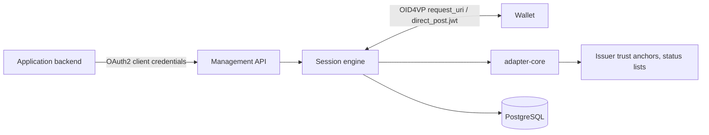

# Architecture

Status: in development. Nothing here describes released features unless the [feature matrix](standards-matrix.md) says so.

## Goal

An application with no wallet protocol code of its own calls a tenant-scoped REST API to request a credential presentation, sends the user to a wallet, and receives a verified, minimized result by polling, optionally prompted by a signed webhook.



## Modules

| Module | Responsibility | Depends on |
| --- | --- | --- |
| `adapter-core` | Verify SD-JWT VC presentations, evaluate DCQL, validate issuer certificate chains, check status lists, sign requests, decrypt responses, minimize claims. ISO mdoc is planned | Nimbus JOSE+JWT and the JDK. No framework |
| `adapter-verifier-service` | Management API, session lifecycle, wallet-facing OID4VP endpoints, result delivery | `adapter-core`, Quarkus, PostgreSQL |

`adapter-core` is usable on its own by any Java application that wants to verify presentations without the service.

## Trust boundaries

| Boundary | Inbound | Trust level | Control |
| --- | --- | --- | --- |
| Wallet to service | `request_uri` fetch, `direct_post.jwt` response | Untrusted, anonymous | Opaque request handles, per-request state, nonce and decryption key, single-use completion |
| Application to service | Session create, read, result, cancel | Authenticated client, tenant-scoped | OAuth2 access token validated locally; tenant taken from the token, never from the path |
| Service to the internet | Status lists, trusted lists and CRLs; OCSP not implemented | Untrusted content, URLs partly attacker-influenced | Egress policy (no private, loopback or link-local addresses), size and time limits, signature checks |
| Operator to service | Tenant, policy and key configuration | Trusted | Separate administrative credentials |

## Core design

### Explicit outcomes

Status checks return `VALID`, `INVALID`, `SUSPENDED`, `OTHER` or `INDETERMINATE`. The default policy rejects `INDETERMINATE`, including an unreachable status list. Failures carry a stable lower-snake-case code (`VerificationFailure`) that is safe to return to API callers; messages never contain credential content.

### Ports

The core holds no global state, and network access goes only through the `HttpFetcher` port:

| Port | Purpose |
| --- | --- |
| `HttpFetcher` | Fetch status lists and trusted lists under an egress policy; `JdkHttpFetcher` refuses non-public addresses, plain HTTP and redirects |
| Trust store supplier | `Supplier<TrustStore>`: trusted certificates with the list each came from, consulted on every verification so list updates apply |
| `java.time.Clock` | Current time, injectable in tests |
| `IssuerKeyResolver` | How the issuer key is found: `x5c` chain (HAIP) or a static key map |

Request-signing keys are in-process for now; a KMS or PKCS#11 signer is planned.

### Algorithms

JWS and JWE algorithms are fixed by an allowlist per trust profile, and the verification algorithm is derived from the trusted key, never taken from the token header alone. `none` and symmetric algorithms are rejected for credentials and presentations.

## Service design

**Sessions.** `POST /v1/verification-sessions` stores a session with an unguessable id and request handle, bound to the calling client's tenant, the policy and the configuration revision. Every application-facing query filters by tenant and client, so another client's session id returns 404.

**Request instances.** Each fetch of the `request_uri` creates a new request instance: fresh `nonce`, `state` and ECDH-ES P-256 key pair, and a newly signed request object. The private key is stored encrypted. Several fetches of one session never share key material.

**Responses.** The wallet posts `direct_post.jwt`. The service finds the request instance by the JWE `kid`, decrypts with that instance's key, checks `state`, then marks the instance used in one conditional update; a second post of the same response fails. Verification runs the policy's verifier: SD-JWT VC with key binding to the tenant's client identifier and the instance's nonce, issuer chain to the policy's anchors, status, DCQL. The session then moves from `pending` to a terminal state in one conditional update that also requires it to be unexpired; late, duplicate or cancelled responses change nothing.

**Results.** Only claims mapped by the policy's `output` are kept, encrypted with a per-tenant key derived from `EUDIW_DATA_KEY`, and deleted on first retrieval or after the result TTL. The raw presentation is never stored. Same-device sessions return `redirect_uri` with a one-time `response_code` to the wallet; result retrieval requires it.

**Trusted lists.** Each policy can name signed ETSI trusted lists (TS 119 612 XML, including the EU list of trusted lists, and TS 119 602 JSON). Each node loads them at startup and hourly. Certificates of approved services of the configured types join the policy's anchors until the list's next update ([ADR-006](adr/0006-trusted-lists.md)).

**Webhooks.** When a session ends, the same statement queues a notification for clients with a webhook. Each node sends due notifications, signed as Standard Webhooks specify, with retries; the body names the session and status only ([ADR-008](adr/0008-webhooks.md)).

**Audit.** Each decision records tenant, session, client, action, outcome, reason code and configuration revision. No claims, tokens or credentials.

**Background sweep.** Every 30 seconds, overdue sessions expire, unretrieved results are deleted and per-request keys older than an hour are removed. Safe on every node.

## Repository layout

```text
pom.xml                       Java 21 reactor
adapter-core/                 verification library
adapter-verifier-service/     Quarkus service, Flyway schema, Dockerfile
deploy/compose/               local demo
openapi/                      management API contract
docs/
```
